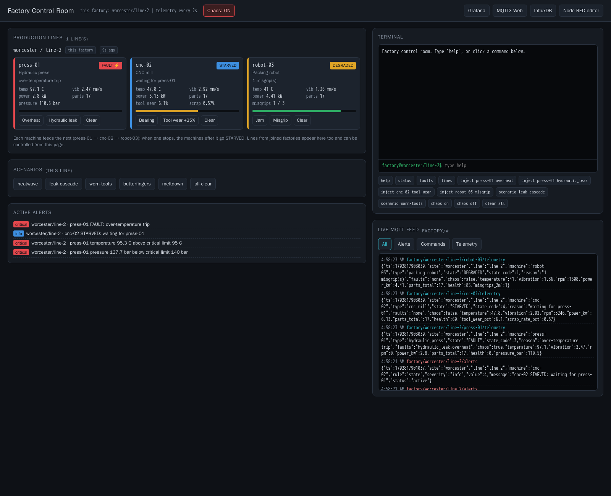
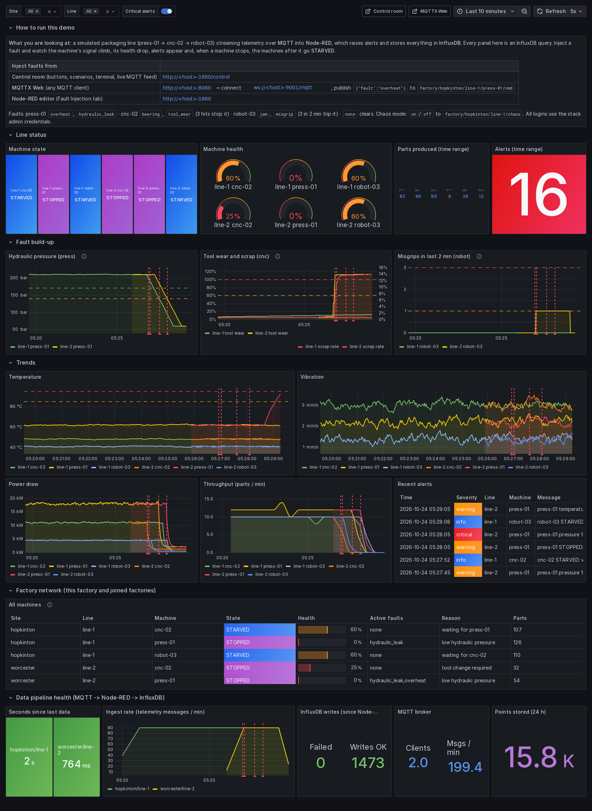

# infra-dev-apps

Example blueprints for the **Dell Automation Platform (DAP)**, mainly targeting **Dell Distributed Private Cloud (DDPC)** Endpoints. Each top-level YAML file is a separate entry point you choose when you upload the blueprint.

## Table of Contents

1. [Introduction](#1-introduction)
   - [Purpose](#purpose)
   - [Entry points at a glance](#entry-points-at-a-glance)
   - [Core features](#core-features)
   - [Plugins](#plugins)
   - [Repository layout](#repository-layout)
2. [Before you deploy](#2-before-you-deploy)
   - [Prerequisites](#prerequisites)
   - [Creating secrets](#creating-secrets)
3. [simple_vm](#3-simple_vm)
4. [iot_factory](#4-iot_factory)
   - [iot_factory on a new DDPC VM](#iot_factory-on-a-new-ddpc-vm)
   - [iot_factory on a simple_vm deployment](#iot_factory-on-a-simple_vm-deployment)
5. [it_toolkit_compose](#5-it_toolkit_compose)
6. [compose_app](#6-compose_app)
7. [Deploying and tearing down](#7-deploying-and-tearing-down)
8. [Known issues and limitations](#8-known-issues-and-limitations)
9. [Changelog](#9-changelog)

---

## 1. Introduction

### Purpose

infra-dev-apps is a **template and training collection**. Each entry point is a small, working deployment that shows a specific set of DAP blueprint techniques: VM creation on a DDPC Endpoint, container deployment straight onto the Endpoint, configuring a VM over the Endpoint proxy with Ansible or Fabric, layering one deployment on top of another, and reaching a host outside DDPC.

Use it to:

- **Demonstrate** DAP and DDPC with few inputs and sensible defaults.
- **Learn** how blueprints are put together. Each chapter below walks through the node templates in execution order.
- **Start a new blueprint.** Copy an entry file plus its component directory, rename it, and swap the payload.

### Entry points at a glance

| Entry file | Deploys | Deploy On | Plugins |
|---|---|---|---|
| [`simple_vm_example_for_DDPC.yaml`](#3-simple_vm) | An Ubuntu cloud-init VM, and returns its login details | DDPC Endpoint | edge, utilities, fabric |
| [`iot_factory_remote_host_example.yaml`](#4-iot_factory) | An interactive IoT Smart Factory demo (Mosquitto, Node-RED line simulator and control room, InfluxDB, Grafana, MQTTX Web) on a fresh **Ubuntu 24.04** host, installed end-to-end by Ansible over SSH. Factories can join each other. | none (any orchestrator) | ansible |
| [`iot_factory_vm_for_DDPC.yaml`](#iot_factory-on-a-new-ddpc-vm) | The same IoT Smart Factory demo on a **new Ubuntu 24.04 VM** that the deployment creates (the simple_vm nodes), installed by Ansible through the Endpoint proxy | DDPC Endpoint | edge, utilities, fabric, ansible |
| [`iot_factory_layered_for_DDPC.yaml`](#iot_factory-on-a-simple_vm-deployment) | The same IoT Smart Factory demo on the VM of an **existing simple_vm deployment** (Ubuntu 24.04), installed by Ansible through the Endpoint proxy | simple_vm deployment | ansible |
| [`it_toolkit_compose_for_DDPC.yaml`](#5-it_toolkit_compose) | The **Site IT Toolkit** directly on the Endpoint: a status page with health checks, push alerts, a LAN speed test and an IT toolbox, from a fixed compose file, with an optional registry login | DDPC Endpoint | edge |
| [`compose_app_example_for_DDPC.yaml`](#6-compose_app) | **Any** user-supplied compose definition directly on the Endpoint, with an optional registry login and Day-2 updates | DDPC Endpoint | edge |

### Core features

- **VM lifecycle on DDPC:** OS image upload, cloud-init (users, SSH keys, netplan), and VM creation with the edge-plugin `NativeEdgeVM` node type.
- **Networking:** DHCP or static IP, an optional gateway and DNS, bridged or NAT virtual network segments, NAT port-forward rules, and up to two NICs.
- **Device passthrough:** USB, serial, GPU, video and PCIe devices. The pick lists are filled from the Endpoint's live hardware inventory.
- **Generated SSH keys:** an RSA key pair is created and stored in the DAP secret store, then reused for VM login and by layered blueprints.
- **Password handling:** the VM password is read from a secret and hashed with bcrypt for cloud-init at deploy time.
- **Endpoint proxy (eo-proxy):** Ansible and Fabric reach the VM through the DDPC Endpoint's management channel, so the VM doesn't need to be reachable from the orchestrator.
- **Containers directly on the Endpoint:** the edge-plugin `NativeEdgeCompose` node type, from a fixed compose file shipped in the blueprint (it_toolkit_compose) or a validated user definition (compose_app). Both support an optional registry login with TLS verification.
- **Layering:** iot_factory_layered_for_DDPC is deployed *on* a simple_vm deployment and reads its details with `get_environment_capability`. Uninstalling it removes the demo and leaves the VM.
- **Day-2:** compose_app supports drift detection and deployment update (`check_drift` / `update` / `postupdate`).
- **Beyond DDPC:** iot_factory builds a full IoT demo on any SSH-reachable Ubuntu 24.04 host with Ansible over plain SSH. The two DDPC entries run the same playbooks through the eo-proxy, on a VM they create or on an existing simple_vm VM.
- **DAP UI techniques:** input groups, conditional inputs (`only_with` / `exclusive_with`), constraints filled from inventory, hidden "advanced" inputs, and `dsl_definitions` anchors.

### Plugins

| Plugin | Imported as | Provides | Used by |
|---|---|---|---|
| **edge-plugin** | `>=3.3.33.0,<4.0.0.0` | `NativeEdgeVM`, `BinaryImage`, `NativeEdgeCompose`, `RegistryLogin` node types | simple_vm, iot_factory (DDPC VM), it_toolkit_compose, compose_app |
| **utilities-plugin** | `>=3.2.3.0,<4.0.0.0` | `dell.nodes.keys.RSAKey` (SSH key pair), `dell.nodes.CloudInit.CloudConfig` | simple_vm, iot_factory (DDPC VM) |
| **fabric-plugin** | `>=3.4.3.0,<4.0.0.0` | `run_script` over SSH through the eo-proxy | simple_vm, iot_factory (DDPC VM) |
| **ansible-plugin** | `>=4.1.9.0,<5.0.0.0` | `dell.nodes.ansible.Executor` (playbooks over direct SSH, or through the eo-proxy) | iot_factory (all three entries) |
| Script plugin (built in) | none | Python operations run on the deployment agent (`central_deployment_agent`) | simple_vm, iot_factory (both DDPC entries), it_toolkit_compose, compose_app |

Plugins are imported in the entry files only (each `definitions.yaml` relies on them). The minimums are the versions DDPC 4.3.0.0 ships; older DDPC releases are not supported.

### Repository layout

Each entry file at the root holds only the metadata: `imports` (including all plugin imports), `input_groups`, `labels` and `blueprint_labels`. The logic lives in a component directory, split into `definitions.yaml` (node templates), `inputs.yaml` and `capabilities.yaml` (`outputs.yaml` in `vm/`).

```
infra-dev-apps/
├── simple_vm_example_for_DDPC.yaml        → vm/
├── iot_factory_remote_host_example.yaml   → iot_factory/
├── iot_factory_vm_for_DDPC.yaml           → vm/ + iot_factory/ddpc_vm/ (uses iot_factory/ playbooks and inputs)
├── iot_factory_layered_for_DDPC.yaml      → iot_factory/ddpc_layered/ (uses iot_factory/ playbooks and inputs, vm/scripts/get_target_id.py)
├── it_toolkit_compose_for_DDPC.yaml       → site_it_toolkit/
├── compose_app_example_for_DDPC.yaml      → compose_app/
├── vm/                    simple_vm component
│   ├── definitions.yaml, inputs.yaml, outputs.yaml
│   ├── scripts/           network, serial-port, password, netplan, proxy and IP helpers
│   └── templates/         netplan_config.yaml
├── iot_factory/           Ansible node templates (direct SSH); remote_host_inputs.yaml; inputs.yaml (shared)
│   ├── ddpc_vm/           Ansible node templates and capabilities for a VM the deployment creates (eo-proxy)
│   ├── ddpc_layered/      Ansible node templates and capabilities for an existing simple_vm VM (eo-proxy)
│   └── playbooks/         preflight, install/teardown Docker, deploy/teardown/verify stack, join/leave hub, templates/, files/ (flows, dashboards), callback_plugins/
├── site_it_toolkit/
│   ├── compose/           site_it_toolkit.yaml (the whole stack configuration)
│   └── scripts/           prepare_compose_yaml.py
├── compose_app/
│   └── scripts/           compose_ops.py (validation, drift, update gate)
└── CHANGELOG.md
```

---

## 2. Before you deploy

### Prerequisites

| Entry points | Needs |
|---|---|
| All DDPC entry points | A DAP Orchestrator managing an onboarded DDPC Endpoint |
| simple_vm | A bridged or NAT virtual network segment on the Endpoint, and an Ubuntu cloud image the orchestrator can download (public `cloud-images.ubuntu.com` or a private artifact server). Use **Ubuntu 24.04** if you will layer iot_factory onto it. |
| it_toolkit_compose, compose_app | The Endpoint can pull the container images, from the internet (`mirror.gcr.io`, `docker.io`, …) or a local registry |
| iot_factory (remote host) | An **Ubuntu 24.04** host (2 GB+ RAM, 10 GB+ free disk) reachable by SSH from the orchestrator, a user that is root or has `ALL=(ALL) NOPASSWD:ALL` sudo, the matching public key in `~/.ssh/authorized_keys`, and internet access from the host to `download.docker.com`, the Ubuntu apt mirrors and Docker Hub. Ports 1880, 1883, 1885, 3000, 8080, 8086 and 9001 (or the ones you choose) must be free. A joining factory must reach the hub's bridge port. |
| iot_factory (DDPC VM) | A bridged or NAT segment that gives the VM internet access and is reachable from your browser (a bridged segment with DHCP is simplest), and an OS Image Secret for an **Ubuntu 24.04** cloud image. The same free ports and internet access as above. |
| iot_factory (layered) | A running **simple_vm** deployment built from an **Ubuntu 24.04** cloud image, on a network segment that gives the VM internet access and is reachable from your browser (a bridged segment with DHCP is simplest). The same free ports and internet access as above. |

### Creating secrets

Secrets are created in the Orchestrator UI under **Administration > Security > Secrets**. Blueprint inputs take the secret's **name**, not its value. The names below are examples; any name works.

| Secret | UI type | Fields | Used by |
|---|---|---|---|
| OS image | Binary Configuration | Binary Image Url, Access User, Access Token, Version | simple_vm, iot_factory (DDPC VM) |
| VM password | Password | Password | simple_vm, iot_factory (DDPC VM) |
| Registry login | Basic Auth Credentials | Username, Password | it_toolkit_compose, compose_app (optional) |
| Remote host SSH key | SSH private key | SSH Private Key | iot_factory (remote host) |
| Stack admin login | Basic Auth Credentials | Username, Password (8+ characters) | iot_factory |
| Bridge login | Basic Auth Credentials | Username (different from the stack login), Password (8+ characters) | iot_factory hub (Accept Joins) |

**OS image (Binary Configuration)**

```
Key:   os-image-secret
Type:  Binary Configuration
Binary Image Url:          https://cloud-images.ubuntu.com/noble/current/noble-server-cloudimg-amd64.img
Binary Image Access User:  # blank for the public image, or your artifact-server user
Binary Image Access Token: # blank for the public image, or your artifact-server token
Binary Image Version:      24.04
```

**VM password (Password)**: the plain-text password for the VM user. It is hashed with bcrypt at deploy time.

```
Key:   vm-password
Type:  Password
Password Schema: <your password>
```

**Registry login (Basic Auth Credentials)**: only needed when **Registry Login** is enabled in it_toolkit_compose or compose_app.

```
Key:   compose-registry-credentials
Type:  Basic Auth Credentials
Username: <registry user>
Password: <registry password or token>
```

**Remote host SSH key (SSH private key)**: if you don't have a key pair yet, create one on the remote host:

```bash
ssh-keygen -m PEM -t rsa
cat ~/.ssh/id_rsa.pub >> ~/.ssh/authorized_keys
cat ~/.ssh/id_rsa        # paste this output into the secret
```

```
Key:   remote-host-private-key
Type:  SSH private key
SSH Private Key Schema: <contents of id_rsa>
```

> **Generated secrets.** simple_vm and the iot_factory DDPC VM entry also *create* two secrets, `example_key_private` and `example_key_public` (the `ssh_keys` node). Because `use_secrets_if_exist` is `true`, every VM deployment reuses the same key pair.

---

## 3. simple_vm

**Entry file:** `simple_vm_example_for_DDPC.yaml` · **Component:** `vm/` · **Deploy On:** a DDPC Endpoint

### Description

Creates an Ubuntu VM on a DDPC Endpoint with cloud-init, from the cloud image in the OS Image Secret (22.04 and 24.04 are tested). It sets up a sudo user with password and SSH-key login, configures one or two NICs, and can pass Endpoint devices through. When the VM is up, the deployment returns the details needed to log in. Its `vm/` component is reused by the [iot_factory DDPC VM entry](#iot_factory-on-a-new-ddpc-vm), and it is the base that the [layered iot_factory](#iot_factory-on-a-simple_vm-deployment) layers onto.

Use it as a template for any VM-based workload on DDPC.

### Secrets

| Input | Secret type | Required | Purpose |
|---|---|---|---|
| `os_image_secret` | Binary Configuration | Yes | Where to download the OS image. Hidden inputs read the URL, user and version from it; the BinaryImage node reads the token. |
| `vm_password` | Password | Yes | Plain-text password for the VM user, hashed with bcrypt for cloud-init |

### Inputs

A dash in **Default** means the input is required. **Upd** shows whether the input can be changed by a deployment update.

**Deployment Artifacts**

| Input | Label | Type | Default | Upd | Notes |
|---|---|---|---|---|---|
| `os_image_secret` | OS Image Secret for Virtual Machine creation | secret_key | – | ✗ | Schema `binary_configuration`. The OS of a running VM can't change. |

**DDPC Virtual Machine**

| Input | Label | Type | Default | Upd | Notes |
|---|---|---|---|---|---|
| `vm_hostname` | VM Hostname | string | `edgehost` | ✗ | Letters, digits and hyphens, at most 63 characters |
| `vm_user_name` | VM Username | string | `edgeuser` | ✗ | No leading or trailing spaces |
| `vm_password` | VM Password | secret_key | – | ✗ | Schema `password` |
| `vcpus` | vCPUs | integer | `2` | ✓ | At least 2 |
| `memory_size` | Memory Size | string | `4GB` | ✓ | Number + unit (`KB` … `YB`) |
| `os_disk_size` | OS Disk Size | string | `50GB` | ✓ | Number + unit (`KB` … `YB`) |
| `disk_wrapper` | Endpoint Datastore Path | string | – | ✗ | Picked from the Endpoint's datastores |

**Device Passthrough**

| Input | Label | Type | Default | Upd | Notes |
|---|---|---|---|---|---|
| `use_passthrough` | Enable device passthrough | boolean | `false` | ✗ | Shows the device lists below |
| `usb` | USB Device list | list (string) | `[]` | ✗ | Only with `use_passthrough`; picked from the Endpoint's USB devices |
| `serial_port_wrapper` | Serial Port | list (string) | `[]` | ✗ | Only with `use_passthrough`; picked from the Endpoint's serial ports |
| `gpu` | GPU Passthrough | list (string) | `[]` | ✗ | Only with `use_passthrough`; picked from the Endpoint's GPUs |
| `video` | Video Passthrough | list (string) | `[]` | ✗ | Only with `use_passthrough`; `onboard controller` |
| `pcie` | PCIe Passthrough | list (string) | `[]` | ✗ | Only with `use_passthrough`; picked from the Endpoint's PCIe devices |

**Network Configuration**

| Input | Label | Type | Default | Upd | Notes |
|---|---|---|---|---|---|
| `vnic_0_segment_name` | Virtual Network Segment name for Management Interface | string | – | ✗ | Picked from the Endpoint's virtual network segments |
| `use_dhcp` | Use DHCP | boolean | `true` | ✗ | Clear it to set a static IP |
| `static_ip` | Static IP and CIDR prefix | string | – | ✗ | Hidden when `use_dhcp` is set; e.g. `192.168.0.100/24` |
| `use_gateway` | Use Gateway | boolean | `false` | ✗ | Hidden when `use_dhcp` is set |
| `gateway` | Gateway IP | string | – | ✗ | Only with `use_gateway`; IPv4 |
| `use_dns` | Use DNS | boolean | `false` | ✗ | Hidden when `use_dhcp` is set |
| `dns` | DNS Servers | list | `[]` | ✗ | Only with `use_dns` |
| `use_nat` | Enable NAT Port Forwarding | boolean | `false` | ✗ | Shows the port-forward rules |
| `port_forward_rules` | Port Mapping | list (`port_forward_rules`) | `[]` | ✗ | Only with `use_nat`; see [NAT port-forward rules](#nat-port-forward-rules) |
| `add_second_nic` | Add Second NIC | boolean | `false` | ✗ | Shows the second-NIC inputs |
| `vnic_1_segment_name` | Second Virtual Network Segment name | string | – | ✗ | Only with `add_second_nic` |
| `use_dhcp2` | Use DHCP on second NIC | boolean | `true` | ✗ | Only with `add_second_nic` |
| `static_ip2` | Static IP and CIDR prefix for second NIC | string | – | ✗ | Only with `add_second_nic`; hidden when `use_dhcp2` is set |
| `use_dns2` | Use DNS on second NIC | boolean | `false` | ✗ | Only with `add_second_nic`; hidden when `use_dhcp2` is set |
| `dns2` | DNS Servers for second NIC | list | `[]` | ✗ | Only with `use_dns2` |
| `use_nat2` | Enable NAT Port Forwarding on second NIC | boolean | `false` | ✗ | Only with `add_second_nic` |
| `port_forward_rules2` | Port Mapping2 | list (`port_forward_rules`) | `[]` | ✗ | Only with `use_nat2` |

<details>
<summary><b>Hidden (advanced) inputs</b>: set <code>hidden: false</code> in <code>vm/inputs.yaml</code> and add the input to an <code>input_groups</code> entry to show it in the UI</summary>

| Input | Type | Default | Notes |
|---|---|---|---|
| `os_type` | string | `UBUNTU22.04` | VM OS type (Ubuntu, RHEL, Windows variants) |
| `hardware_options.vTPM` | boolean | `false` | Required for Windows 11 |
| `hardware_options.secure_boot` | boolean | `false` | Required for Windows 11 |
| `hardware_options.firmware_type` | string | `BIOS` | `BIOS` or `UEFI` (UEFI for Windows 11) |
| `disk_controller` | string | `VIRTIO` | `VIRTIO`, `SATA` or `SCSI`. Can't be changed by a deployment update. |
| `disk` | string | `disk_wrapper` | Datastore path passed to the VM |
| `enable_management` | boolean | `true` | Creates the management tap interface that the eo-proxy uses |
| `cloudinit` | string | `""` | Extra cloud-config merged into the generated one |
| `iso_files` | list (string) | `[]` | Catalog ISO files to attach |
| `additional_disks` | list | `[]` | Catalog disks to attach |
| `boot_order` | list (string) | `[]` | VM boot order |
| `serial_port` | list (string) | `serial_port_wrapper` | Serial-port list passed to the VM |
| `binary_image_url` | string | from `os_image_secret` | Image URL |
| `binary_image_access_user` | string | from `os_image_secret` | Image repository user |
| `binary_image_version` | string | from `os_image_secret` | Logical image version |

</details>

#### NAT port-forward rules

Each `port_forward_rules` entry has these fields:

| Field | Notes |
|---|---|
| `host_ip` | Host network IP of the Endpoint interface where the NAT segment is created |
| `host_port` | Port to connect to on `host_ip` |
| `protocol` | `TCP` or `UDP` |
| `service_type` | `HTTP`, `SSH` or `CUSTOM` |
| `vm_port` | The application's port inside the VM |
| `vm_ip` | Leave blank with DHCP; set it only with a static IP |

A NAT-type virtual network segment must be selected for the rules to apply.

### Node template step-through

Defined in `vm/definitions.yaml`, in execution order:

1. **`ssh_keys`** (`dell.nodes.keys.RSAKey`): creates an OpenSSH RSA key pair and stores it as the `example_key_private` / `example_key_public` secrets. If they already exist, it reuses them.
2. **`binary_image`** (edge `BinaryImage`): validates the image settings read from `os_image_secret` (the access token is read straight from the secret), then uploads the image to the Endpoint. Uninstall deletes it.
3. **`prepare_config`** (script operations on the deployment agent):
   - `precreate` → `prepare_network_settings.py` builds the NIC list from the segment names and NAT rules.
   - `create` → `prepare_serial_ports.py` converts the selected serial ports to the VM port format.
   - `start` → `prepare_passwd.py` reads `vm_password` and stores a bcrypt hash.
4. **`cloudinit`** (`dell.nodes.CloudInit.CloudConfig`): `precreate` renders `vm/templates/netplan_config.yaml` from the network inputs (`prepare_netplan_config.py`). `create` builds the cloud-config: hostname, the netplan file, an SSH keep-alive, the sudo user with the hashed password and the generated public key, plus any extra `cloudinit` input. It depends on `ssh_keys` and `prepare_config`.
5. **`vm`** (edge `NativeEdgeVM`): creates the VM on the Endpoint from `get_environment_capability: ece_service_tag`. It uses the uploaded image, CPU/memory/disk, hardware options, network settings, passthrough devices and the cloud-config. The VM is named after the deployment. It depends on `cloudinit`, `binary_image` and `prepare_config`.
6. **`vm_info`**:
   - `create` → `get_target_id.py` resolves the Endpoint and stores the eo-proxy `connection_proxy_settings`.
   - `start` → Fabric runs `get_vm_info.sh` in the VM over that proxy (using the generated key). It waits for an IPv4 address on `enp1s0` and publishes it as `vm_public_ip`.
   - `preupdate` / `update` repeat these steps, so a deployment update refreshes the IP.

**Uninstall** deletes the VM and the uploaded image. The generated key secrets are kept so that other deployments can reuse them.

### Capabilities

| Capability | Value |
|---|---|
| `service_tag` | Endpoint service tag |
| `vm_name` | VM name (the deployment name) |
| `vm_hostname` | `vm_hostname` input |
| `vm_ip` | VM IPv4 address on `enp1s0` |
| `vm_user_name` | `vm_user_name` input |
| `vm_ssh_private_key` | Name of the private-key secret (`example_key_private`) |

---

## 4. iot_factory

**Entry files:** `iot_factory_remote_host_example.yaml` (this chapter), `iot_factory_vm_for_DDPC.yaml` ([on a new DDPC VM](#iot_factory-on-a-new-ddpc-vm)) and `iot_factory_layered_for_DDPC.yaml` ([on a simple_vm deployment](#iot_factory-on-a-simple_vm-deployment)) · **Component:** `iot_factory/` · **Deploy On:** not needed (remote host), a DDPC Endpoint (DDPC VM) or a simple_vm deployment (layered)

> **Tested only on Ubuntu 24.04 LTS** (x86_64). The first node checks `/etc/os-release` and **stops the deployment before changing anything** if the host is not Ubuntu 24.04.

### Description

The collection's showcase demo. Ansible connects to **any SSH-reachable Ubuntu 24.04 host**, starting from a fresh install, and deploys an **IoT Smart Factory**:

```
 Node-RED "Line Simulator"  --MQTT-->  Mosquitto  --MQTT-->  Node-RED rules engine  -->  InfluxDB  -->  Grafana
 (3 simulated machines)                   ^   ^               (alerts, health)
                                          |   +-- browser clients (MQTTX Web, control room) and joined factories (bridge)
                                          +------ fault commands (buttons, REST, terminal, MQTT)
```

| Service | Image | Port | Role |
|---|---|---|---|
| Mosquitto | `eclipse-mosquitto:2.0.22` | 1883, 9001 (websockets) | MQTT broker. Both published listeners need the stack login. An anonymous listener (1884) is reachable only on the compose network. |
| Node-RED | `nodered/node-red:4.1.1` | 1880 | Line simulator, fault engine, rules engine, InfluxDB writer and the **control room** (`/control`). Core nodes only. |
| InfluxDB 2 | `influxdb:2.7.12` | 8086 | Telemetry, alerts and pipeline stats (org `iot-factory`, bucket `telemetry`, 7-day retention), plus a **Database Health** dashboard |
| Grafana | `grafana/grafana-oss:11.6.0` | 3000 | **IoT Smart Factory** home dashboard |
| MQTTX Web | `emqx/mqttx-web:v1.13.0` | 8080 | Browser MQTT client for publishing commands and watching topics |



### The line simulator

There is no real hardware. A Node-RED function **pretends to be a packaging line** and publishes what real PLCs or sensors would. Everything after the broker is the same as in a real plant.

The three machines feed each other: **press-01 (hydraulic press) → cnc-02 (CNC mill) → robot-03 (packing robot)**. Every 2 s (configurable), each one publishes temperature, vibration, rpm, power, parts produced, a health score, its state and its build-up signal to `factory/<site>/<line>/<machine>/telemetry`.

| State | Meaning |
|---|---|
| RUNNING | Normal |
| DEGRADED | A fault is building up (warnings) |
| STOPPED | Jammed, out of hydraulic pressure, or waiting for a tool change |
| FAULT | Tripped on a safety limit. Latched until the fault is cleared. |
| STARVED | An upstream machine stopped, so no parts arrive (after a 15 s buffer) |

### Faults

| Machine | Fault | Type | What happens |
|---|---|---|---|
| press-01 | `overheat` | sustained | Temperature climbs: warning at 85 °C (~20 s), trip at 95 °C (~40 s) |
| press-01 | `hydraulic_leak` | sustained | Pressure bleeds from 210 bar: warning below 170, the press **stops** below 140 (~50 s), then cnc-02 and robot-03 go **STARVED** |
| cnc-02 | `bearing` | sustained | Vibration climbs: warning at 7 mm/s, trip at 11 mm/s |
| cnc-02 | `tool_wear` | **cumulative** | Each hit adds 35 % tool wear. Scrap rate climbs above 60 % wear (warning at 5 %, critical at 10 %). The **3rd hit stops the mill** for a tool change, and robot-03 starves. |
| robot-03 | `jam` | sustained | The robot stops at once |
| robot-03 | `misgrip` | **cumulative** | Each hit drops a part and raises a warning. **3 misgrips within 2 minutes trip a safety stop.** |
| any or `all` | `none` | | Clears faults and trips, changes the tool and resets misgrips |

**Scenarios** chain faults for you. Run them from the control room, the terminal (`scenario <name>`) or `POST /api/scenario`:

| Scenario | What it does |
|---|---|
| `heatwave` | Overheat on the press, bearing wear on the mill |
| `leak-cascade` | Hydraulic leak: the press stops, then the line starves downstream |
| `worn-tools` | Three tool-wear hits 8 s apart |
| `butterfingers` | Three misgrips 6 s apart |
| `meltdown` | Every sustained fault, plus chaos mode |
| `all-clear` | Clears this line (chaos mode unchanged) |

**Chaos mode** injects a random fault every 45–120 s and repairs that machine 2 minutes later. It runs **alongside** faults you inject by hand: manual faults are never cleared by chaos, and chaos-hit machines are marked ⚡ in the control room. Turn it on with the **Auto Chaos Mode** input, or at runtime from the control room, the terminal (`chaos on|off`), the Node-RED buttons or MQTT (`on`/`off` to `factory/<site>/<line>/chaos`).

### Running the demo

1. Open **Grafana** (`grafana_dashboard_url`, anonymous view by default). The **How to run this demo** panel at the top has every link and topic for this deployment.
2. Open the **control room** (`control_room_url`) and log in with the stack credentials. You get:
   - live machine cards with fault buttons for every line, including joined factories
   - scenario buttons and the chaos toggle
   - a **terminal**: type `help`, or click a pre-canned command (`inject press-01 hydraulic_leak`, `scenario worn-tools`, `chaos on`, `status`, `lines`…)
   - a **live MQTT feed** of `factory/#`, filterable to alerts, commands or telemetry
3. Or use plain MQTT: open **MQTTX Web** (`mqttx_web_url`) and create a connection to `mqtt_websocket_url` (`ws://<host>:9001/mqtt`) with the stack login. Subscribe to `factory/#`, and publish `{"fault":"overheat"}` to `factory/<site>/<line>/press-01/cmd`. From a terminal, the same works with `mosquitto_pub -h <host> -u <user> -P <password> -t … -m …` on port 1883.
4. Or use REST (basic auth): `curl -u <user>:<password> -H 'Content-Type: application/json' -d '{"machine":"press-01","fault":"overheat"}' http://<host>:1880/api/fault`. Other endpoints are `GET /api/status`, `POST /api/chaos {"enabled":true}`, `POST /api/scenario {"name":"leak-cascade"}`, `POST /api/console {"command":"help"}` and `GET /api/feed`.

Alerts are published to `factory/<site>/<line>/alerts`, stored in InfluxDB, listed in Grafana's **Recent alerts** table and drawn as red annotations on every chart.



**Grafana rows:**
- **How to run this demo**
- **Line status**: state, health, parts and alerts
- **Fault build-up**: hydraulic pressure, tool wear and scrap, misgrips
- **Trends**
- **Factory network**: every machine on every joined line
- **Data pipeline health**: seconds since last data, ingest rate, InfluxDB write counts, broker clients and load, points stored

The **Site** and **Line** selectors filter every panel when factories are joined.

**InfluxDB** (`influxdb_url`, stack login) has its own **IoT Factory – Database Health** dashboard (Dashboards menu), showing readings and alerts stored, lines reporting, failed writes, ingest rate and broker load. Raw data is in **Data Explorer**, bucket `telemetry`.

### Joining factories

1. **Hub:** deploy (or redeploy) one factory with **Accept Joins** set to true and a **Bridge Credentials** secret, which is a second Basic Auth Credentials secret with a different username from the stack login. The `accept_joins` node opens a dedicated bridge listener on **Bridge Port** (default 1885). Its own password file and ACL let the bridge user **only publish `factory/+/+/+/telemetry` and receive `…/cmd` and `…/chaos`**, and deny the hub's own line entirely. A joiner can't impersonate the hub's line, read alerts, send commands or use the stack admin login. Factories that share one bridge secret are trusted with each other's lines (a joiner could publish telemetry under another joiner's site/line), so give mutually untrusted parties separate hubs.
2. **Joining factory:** deploy the blueprint on a second Ubuntu 24.04 host with a **different Factory Site or Production Line**. Set **Join A Hub Factory** to true, and enter the hub's deployment ID as **Hub Deployment ID**. The `join_hub` node reads the hub's `mqtt_host`, `bridge_port`, `mqtt_topic_root`, `accepts_joins` and `bridge_credentials` capabilities. It then adds a Mosquitto bridge on the joining factory:

- `factory/<site>/<line>/+/telemetry` flows **out** to the hub. The hub's rules engine raises alerts for the new line, its InfluxDB stores it, and its Grafana (Site/Line selectors, Factory network table) and control room show it.
- `factory/<site>/<line>/+/cmd` and `…/chaos` flow **in** from the hub. The hub's control room, terminal (`inject cnc-02 tool_wear worcester/line-2`) and MQTT clients can inject faults into the joined line.

The hub's rules engine validates every telemetry message before storing or displaying it: site, line and machine must be lowercase IDs that match the topic, the state must be a known one, and the metrics must be numeric. Malformed messages are dropped and counted.

Each factory still runs its own stack and dashboards. The hub is the place that sees and controls them all. Any number of factories can join one hub. Uninstalling a joined factory removes its bridge first.

### Secrets

| Input | Secret type | Required | Purpose |
|---|---|---|---|
| `ssh_private_key` | SSH private key | Yes | Private key matching an `authorized_keys` entry on the remote host |
| `stack_admin_credentials` | Basic Auth Credentials | Yes | One login for the Node-RED editor, control room and API, Grafana admin, InfluxDB admin and the MQTT users. The password must be at least 8 characters, and the username must not contain `:` |
| `bridge_credentials` | Basic Auth Credentials | Hub only (Accept Joins) | The login joining factories use for the bridge listener. Use a different username from the stack login; the password must be at least 8 characters. |

The credentials never appear in compose files or environment variables. They are written to `/opt/iot-factory/secrets` (a root-only directory) and mounted as compose secrets. Node-RED and Mosquitto store only hashes (bcrypt / PBKDF2). A joining factory reads the hub's **bridge** credentials secret by name from the hub's `bridge_credentials` capability, and writes them into its bridge config (mode 0600). It never sees the hub's stack admin login.

### Inputs

**Remote host credentials**

| Input | Label | Type | Default | Upd | Notes |
|---|---|---|---|---|---|
| `remote_host` | Remote Host IP Or FQDN | string | – | ✗ | IP address or hostname |
| `remote_username` | Remote Host Username | string | – | ✗ | Linux username; root, or a user with passwordless sudo |
| `ssh_private_key` | SSH Private Key Secret | secret_key | – | ✗ | Schema `ssh_private_key` |
| `remote_port` | Remote Host SSH Port | integer | `22` | ✗ | 1–65535 |

**Smart Factory Demo**

| Input | Label | Type | Default | Upd | Notes |
|---|---|---|---|---|---|
| `stack_admin_credentials` | Stack Admin Credentials Secret | secret_key | – | ✗ | Schema `basic_auth_credentials` |
| `factory_site` | Factory Site | string | `hopkinton` | ✗ | Lowercase letters, digits, hyphens. Used in topics, tags and the dashboard title. |
| `factory_line` | Production Line | string | `line-1` | ✗ | As above |
| `publish_interval` | Telemetry Interval | integer | `2` | ✗ | Seconds, 1–60 |
| `auto_chaos` | Auto Chaos Mode | boolean | `false` | ✗ | Chaos mode at start-up; can be toggled at runtime |
| `grafana_anonymous_viewer` | Grafana Anonymous Viewer | boolean | `true` | ✗ | Read-only dashboards without a login (kiosk screens) |

**Service Ports**: `mqtt_port` (`1883`), `nodered_port` (`1880`), `grafana_port` (`3000`), `influxdb_port` (`8086`), `mqtt_ws_port` (`9001`), `mqttx_web_port` (`8080`), each 1024–65535.

**Factory Network**

| Input | Label | Type | Default | Upd | Notes |
|---|---|---|---|---|---|
| `accept_joins` | Accept Joins (Act As Hub) | boolean | `false` | ✗ | Adds the `accept_joins` node |
| `bridge_credentials` | Bridge Credentials Secret | secret_key | – | ✗ | Shown when `accept_joins` is set. Schema `basic_auth_credentials` |
| `bridge_port` | Bridge Port | integer | `1885` | ✗ | 1024–65535 |
| `join_hub` | Join A Hub Factory | boolean | `false` | ✗ | Adds the `join_hub` node |
| `hub_deployment_id` | Hub Deployment ID | string | `""` | ✗ | Shown when `join_hub` is set. The ID of a running iot_factory deployment with Accept Joins on. |

**Ansible Settings**

| Input | Label | Type | Default | Upd | Notes |
|---|---|---|---|---|---|
| `ansible_debug_level` | Ansible Debug Level | integer | `0` | ✗ | 0–3. Raise only to troubleshoot. |
| `ansible_timeout` | Ansible Timeout | integer | `30` | ✗ | SSH connection timeout, 10–600 s |
| `ansible_log_stdout` | Ansible Log Output | boolean | `true` | ✗ | One line per task in the deployment log. Failures are always logged. |

### Node template step-through

Defined in `iot_factory/definitions.yaml`. All are `dell.nodes.ansible.Executor` nodes connecting over direct SSH (`proxy_settings: disable: true`), chained with `depends_on`:

1. **`preflight`** (`preflight.yaml`): read-only. It reads `/etc/os-release` with `raw` (no Python or facts needed) and rejects anything but Ubuntu 24.04. It then checks the architecture (x86_64/aarch64), RAM (≥ 2 GB), free disk (≥ 10 GB), that the six service ports are free, and outbound HTTPS to `download.docker.com` and Docker Hub. `number_of_attempts: 1`: a failed check is final.
2. **`install_docker`** (`install_docker.yaml`): Docker CE and the compose plugin from Docker's apt repository. An existing Docker engine is left alone. A marker in `/etc/iot-factory` records whether this blueprint installed Docker. **Uninstall** (`stop` → `teardown_docker.yaml`) purges Docker, its repo, key and data **only if** the marker exists.
3. **`deploy_stack`** (`deploy_stack.yaml`): renders `/opt/iot-factory` and runs `docker compose up --wait` until every health check passes. It generates the InfluxDB token on the first run, hashes passwords on the host, and applies the InfluxDB dashboard as an `influx` stack. Re-runs are idempotent: nothing changes or restarts unless an input or file did. **Uninstall** (`stop` → `teardown_stack.yaml`) runs `compose down --volumes --rmi all` and deletes `/opt/iot-factory`.
4. **`verify_demo`** (`verify_demo.yaml`): proves the demo works. It checks that telemetry arrives on MQTT, anonymous MQTT and unauthenticated API calls are refused, and the control room, MQTTX Web and websocket listener are up. It checks that a jam injected through `/api/fault` raises an alert, which it then clears, that telemetry and alerts are in InfluxDB, and that the Grafana dashboard is provisioned.
5. **`accept_joins`** (`accept_joins.yaml`, only when `accept_joins` is true): hashes the bridge password, writes the bridge listener, its password file and its ACL into `mosquitto/config/conf.d/`, and restarts the broker. **Uninstall** (`stop` → `close_joins.yaml`) closes the listener.
6. **`join_hub`** (`join_hub.yaml`, only when `join_hub` is true): checks that the hub accepts joins and that its bridge port is reachable. It writes the Mosquitto bridge, restarts the broker and waits for the bridge to report connected. **Uninstall** (`stop` → `leave_hub.yaml`) removes the bridge.

**Logging:** each playbook prints one line per task and ends with a single `IOT-FACTORY [<node>] OK: …` summary. On failure, it ends with a single `IOT-FACTORY [<node>] FAILED at '<task>': <reason> | <last stderr lines>. Hint: …` line. Search the deployment log for `IOT-FACTORY` to find it; the workflow's own error is the plugin's generic "Number of attempts" text. Two ansible-plugin behaviours shape this:

- The plugin always runs `ansible-playbook -v`, so Ansible's default output would dump every task result into the log (over 1,000 log lines for an install). `playbooks/callback_plugins/iot_factory.py` is the default callback rendered one verbosity level lower: `ansible_debug_level` 0–1 gives one line per task, and 2–3 add detail.
- The plugin adds the full playbook output to a failed operation's error, and with the `json` callback it also reports every task as an error. YAML-formatted default output avoids that.

The plugin also retries failed playbooks (exit code 2), not only unreachable hosts. `preflight` sets `number_of_attempts: 1`, and the other nodes allow one retry. Tasks that handle secrets are `no_log`.

**Playbook downloads:** before each node's first operation, the ansible plugin downloads the **whole blueprint archive**, file by file, into a per-node temporary directory (about 0.5 s per file). It reuses that copy for the same node's later operations (uninstall), but not across nodes. Upload this entry with only its own files (`iot_factory_remote_host_example.yaml`, `iot_factory/`, `CHANGELOG.md`) rather than the whole repository. That keeps each node's download to about 10 s instead of 30 s or more. Sharing one download across nodes is possible: set `playbook_source_path` to `{ get_attribute: [preflight, _blueprint_dir] }`. It was not adopted, because:

- that directory lives in the mgmtworker's `/tmp`, so a pod restart between install and uninstall would break the teardown,
- every node then logs an error-level "hosts already exists" line.

**Uninstall** returns the host to its pre-install state: bridge, stack, volumes, images and, if this blueprint installed it, Docker. `ca-certificates`, `curl` and `python3-debian` stay installed.

### Capabilities

| Capability | Value |
|---|---|
| `grafana_dashboard_url` | `http://<remote_host>:<grafana_port>/d/iot-factory/iot-smart-factory?kiosk&refresh=5s` |
| `control_room_url` | `http://<remote_host>:<nodered_port>/control` |
| `mqttx_web_url` | `http://<remote_host>:<mqttx_web_port>` |
| `mqtt_websocket_url` | `ws://<remote_host>:<mqtt_ws_port>/mqtt` |
| `mqtt_endpoint` | `tcp://<remote_host>:<mqtt_port>` |
| `mqtt_host`, `mqtt_port` | Broker host and client port |
| `accepts_joins`, `bridge_port`, `bridge_credentials` | Join settings read by joining factories (`bridge_credentials` is the secret *name*) |
| `mqtt_topic_root` | `factory/<site>/<line>` |
| `nodered_editor_url` | `http://<remote_host>:<nodered_port>/` |
| `fault_injection_api` | `http://<remote_host>:<nodered_port>/api/fault` |
| `influxdb_url` | `http://<remote_host>:<influxdb_port>` |
| `stack_admin_credentials` | Name of the stack credentials secret |

### iot_factory on a new DDPC VM

**Entry file:** `iot_factory_vm_for_DDPC.yaml` · **Components:** `vm/` + `iot_factory/ddpc_vm/` · **Deploy On:** a DDPC Endpoint

The same demo in one deployment: it creates the **simple_vm** VM (cloud-init, generated SSH key, bcrypt password; see [simple_vm](#3-simple_vm)) and installs the stack into it. Ansible reaches the VM through the **Endpoint proxy** (eo-proxy), so the orchestrator never needs a route to the VM's network.

- **Inputs:** the simple_vm inputs (artifact, VM, device passthrough, network) plus the iot_factory inputs, minus the four remote-host inputs. **`os_image_secret` must point to an Ubuntu 24.04 cloud image**, or preflight stops the deployment. The VM defaults (2 vCPUs, 4 GB RAM, 50 GB disk) are enough. Use 4 vCPUs and 8 GB for a hub with several joined factories.
- **Network:** the services are published on the VM's first NIC, and the capabilities use that IP (`vm_ip`). Choose a **bridged** segment with DHCP or a static IP on a network your browser can reach. On a NAT segment the capabilities show the VM's private address: add port-forward rules for the service ports and use the Endpoint's host IP instead. The VM needs internet access (Docker apt repo, Docker Hub).
- **Nodes:** `ssh_keys` → `binary_image` → `prepare_config` → `cloudinit` → `vm` → `vm_info` (proxy target and VM IP), then `preflight` → `install_docker` → `deploy_stack` → `verify_demo` (→ `accept_joins` / `join_hub`), defined in `iot_factory/ddpc_vm/definitions.yaml`. `ANSIBLE_SSH_RETRIES` is set to 10: each eo-proxy session is published as a new cluster service whose DNS name takes a minute or two to resolve, and without SSH retries every node's first connection fails as unreachable.
- **Uninstall** deletes the VM (and the uploaded image), which removes Docker, the stack and any bridge, so this entry has no teardown playbooks.
- **Capabilities:** the iot_factory capabilities with `<remote_host>` replaced by the VM IP, plus the simple_vm capabilities (`service_tag`, `vm_name`, `vm_ip`, `vm_user_name`, `vm_ssh_private_key`, …).
- **Upload size:** as above, upload this entry with only its own files (`iot_factory_vm_for_DDPC.yaml`, `vm/`, `iot_factory/`, `CHANGELOG.md`) to keep the per-node playbook download short.

### iot_factory on a simple_vm deployment

**Entry file:** `iot_factory_layered_for_DDPC.yaml` · **Component:** `iot_factory/ddpc_layered/` · **Deploy On:** a running [simple_vm](#3-simple_vm) deployment

The same demo, layered onto the VM of an existing simple_vm deployment. It reads the VM's details from the parent with `get_environment_capability` (`service_tag`, `vm_name`, `vm_ip`, `vm_user_name`, `vm_ssh_private_key`), and Ansible reaches the VM through the **Endpoint proxy** (eo-proxy), so the orchestrator never needs a route to the VM's network.

- **Parent VM:** the simple_vm deployment must be built from an **Ubuntu 24.04** cloud image, or preflight stops the deployment before changing anything. The simple_vm defaults (2 vCPUs, 4 GB RAM, 50 GB disk) are enough. Use 4 vCPUs and 8 GB for a hub with several joined factories.
- **Inputs:** the iot_factory inputs above, minus the four remote-host inputs.
- **Network:** the services are published on the VM's first NIC, and the capabilities use the parent's `vm_ip`. Choose a **bridged** segment with DHCP or a static IP on a network your browser can reach. On a NAT segment the capabilities show the VM's private address: add port-forward rules for the service ports to the simple_vm deployment and use the Endpoint's host IP instead. The VM needs internet access (Docker apt repo, Docker Hub).
- **Nodes:** `vm_info` (`get_target_id.py` resolves the eo-proxy target from the parent's service tag), then the same chain as the remote-host entry: `preflight` → `install_docker` → `deploy_stack` → `verify_demo` (→ `accept_joins` / `join_hub`), defined in `iot_factory/ddpc_layered/definitions.yaml`. `ANSIBLE_SSH_RETRIES` is set to 10: each eo-proxy session is published as a new cluster service whose DNS name takes a minute or two to resolve, and without SSH retries every node's first connection fails as unreachable.
- **Uninstall** runs the same teardown playbooks as the remote-host entry (bridge, stack, volumes, images, and Docker if this blueprint installed it) and leaves the VM. Uninstall and delete this deployment before uninstalling its simple_vm parent.
- **Capabilities:** the iot_factory capabilities above, with `<remote_host>` replaced by the parent's VM IP.
- **Joining:** all three entries expose the same join capabilities, so any factory can join a hub deployed from another entry, as long as the joiner can reach the hub's bridge port.
- **Upload size:** as above, upload this entry with only its own files (`iot_factory_layered_for_DDPC.yaml`, `vm/scripts/get_target_id.py`, `iot_factory/`, `CHANGELOG.md`) to keep the per-node playbook download short.

---

## 5. it_toolkit_compose

**Entry file:** `it_toolkit_compose_for_DDPC.yaml` · **Component:** `site_it_toolkit/` · **Deploy On:** a DDPC Endpoint

### Description

Runs the **Site IT Toolkit** as containers **directly on the DDPC Endpoint** (no VM), using the edge-plugin `NativeEdgeCompose` node type. The toolkit gives a branch or edge site a small set of IT tools on the hardware that is already there:

| Service | Image | What it is for | Port |
|---|---|---|---|
| `itk-status` | [Gatus](https://github.com/TwiN/gatus) `v5.37.0` | Status page and health checks: the internet uplink, its TLS certificate (alert below 14 days), the site DNS resolver, one key service you name (TCP or HTTP), and the toolkit itself. Header buttons open the other tools. | 8080 |
| `itk-alerts` | [ntfy](https://ntfy.sh) `v2.29.0` | Push notifications. Gatus posts an alert after 3 failed checks in a row and again on recovery. Subscribe to the topic in a browser, the ntfy phone app or with `curl`. | 8081 |
| `itk-speedtest` | [OpenSpeedTest](https://openspeedtest.com) `v2.0.6` | Browser-based LAN speed test, for "the network is slow" tickets | 3000 |
| `itk-toolbox` | [IT-Tools](https://github.com/CorentinTh/it-tools) | Offline browser toolbox: subnet calculator, certificate / JWT / base64 decoders, hashes, cron and more | 8082 |
| `itk-config` | busybox `1.37.0` | Renders the Gatus configuration into a shared volume and keeps it current (see below) | – |

The stack is **configured entirely in the compose file**, `site_it_toolkit/compose/site_it_toolkit.yaml`. The blueprint only supplies the values of the `${VAR}` references in it (site name, check targets, ports, image registry and the Endpoint IP). The file also shows how to work within the [compose features DDPC supports](#supported-compose-features):

- **Configuration without bind mounts.** The Gatus configuration is inline, in the `GATUS_CONFIG` environment variable of `itk-config`, which writes it to the `gatus_config` named volume that `itk-status` mounts read-only.
- **Name resolution for a scratch image.** Gatus ships as a `scratch` image and gets no `/etc/resolv.conf` on a DDPC Endpoint, so on its own it cannot resolve any host name. Every 30 s `itk-config` fills in the compose network's DNS server (used as each check's `client.dns-resolver`) and the alerts service's IP (alert delivery has no resolver setting), and rewrites the file only when something changed; Gatus reloads it automatically.
- **Service-to-service traffic by name.** Gatus checks and alerts use service names (`http://itk-alerts`, `http://itk-speedtest:3000`). Containers on the Endpoint cannot reach the Endpoint's own published ports, so only the browser links use the Endpoint IP. Service names only resolve inside one compose, so the whole toolkit is a single compose. Containers are named after their service on the Endpoint, hence the `itk-` prefix, which keeps them recognizable in the Endpoint's Containers view.
- **Resource limits** (`deploy.resources.limits`) on every service.
- **An image registry prefix,** so the same file pulls from Docker Hub, a mirror or a Harbor pull-through cache.

Use it as a template for a fixed container stack that ships inside the blueprint.

### Secrets

| Input | Secret type | Required | Purpose |
|---|---|---|---|
| `registry_credentials_secret` | Basic Auth Credentials | Only with `registry_login_enabled` | Username and password for the Endpoint registry login |

### Inputs

All inputs are fixed after deployment (`allow_update: false`).

**Site**

| Input | Label | Type | Default | Notes |
|---|---|---|---|---|
| `site_name` | Site Name | string | `Branch Office` | Status page title and alert text. Letters, numbers, spaces, `.`, `_`, `-`; at most 40 characters. |
| `alert_topic` | Alert Topic | string | `site-it-alerts` | ntfy topic for the alerts. 3–64 letters, numbers, `_` or `-`. Anyone on the site network who knows it can read and post to it, so pick a name that is hard to guess. |

**Health Checks**

| Input | Label | Type | Default | Notes |
|---|---|---|---|---|
| `web_check_url` | Internet Check URL | string | `https://www.dell.com` | Uplink check (connects, status below 400, response under 3 s) and the TLS certificate check (every 10 minutes) |
| `dns_check_server` | DNS Server | string | `1.1.1.1` | IPv4 address of the resolver to watch. Set it to the site's own DNS server. |
| `dns_check_name` | DNS Test Name | string | `www.dell.com` | Name resolved (A record) by the DNS check |
| `key_service_name` | Key Service Name | string | `Dell Support` | Display name of one more service the site depends on |
| `key_service_url` | Key Service Address | string | `https://www.dell.com/support/home` | An `http(s)://` URL, or `tcp://<IPv4>:<port>` (e.g. `tcp://10.0.0.20:445` for a file share). Passes when a connection can be made. TCP checks need an IP address because they can't resolve names on DDPC. |
| `check_interval` | Check Interval | string | `1m` | One of `30s`, `1m`, `2m`, `5m`, `10m` |

**Published Ports**

| Input | Label | Type | Default |
|---|---|---|---|
| `status_port` | Status Page Port | integer | `8080` |
| `alerts_port` | Alerts Port | integer | `8081` |
| `speedtest_port` | Speed Test Port | integer | `3000` |
| `toolbox_port` | IT Tools Port | integer | `8082` |

Ports must be between 1024 and 65535 and free on the Endpoint.

**Container Images**

| Input | Label | Type | Default | Notes |
|---|---|---|---|---|
| `image_registry` | Image Registry | string | `docker.io` | Prefix for every image (`<registry>/<namespace>/<image>:<tag>`). For a mirror or pull-through cache give host and project, e.g. `harbor.example.com/dockerhub`. |

**Registry Login**

| Input | Label | Type | Default | Notes |
|---|---|---|---|---|
| `registry_login_enabled` | Registry Login | boolean | `false` | Creates the `registry_login` node |
| `registry_url` | Registry URL | string | `""` | Only with `registry_login_enabled`; host[:port][/path], no scheme |
| `registry_credentials_secret` | Registry Credentials Secret | secret_key | – | Only with `registry_login_enabled`; schema `basic_auth_credentials` |
| `registry_tls_verify` | Registry TLS Verify | boolean | `true` | Only with `registry_login_enabled`. Turn it off only for registries with self-signed certificates. |

The registry login is affected by a [platform bug on EdgeOS 4.3](#8-known-issues-and-limitations): it reports success but images are still pulled anonymously.

### Customizing the stack

Edit `site_it_toolkit/compose/site_it_toolkit.yaml` and re-upload the blueprint:

- **More health checks:** add entries under `endpoints:` in `GATUS_CONFIG`. Gatus supports HTTP, TCP, DNS, TLS-certificate and more ([conditions](https://github.com/TwiN/gatus#conditions)). Give HTTP checks the same `client.dns-resolver` line as the existing ones, and TCP checks an IP address. Add `[CONNECTED] == true` to HTTP checks: on a failed connection `[STATUS]` is 0, so a condition like `[STATUS] < 400` alone would pass. ICMP (ping) checks need `NET_RAW`, which DDPC containers don't get, so use a TCP check instead.
- **Locking down alerts:** add ntfy's `NTFY_AUTH_DEFAULT_ACCESS`, `NTFY_AUTH_USERS`, `NTFY_AUTH_ACCESS` and `NTFY_AUTH_TOKENS` to the `itk-alerts` service, and give Gatus the token in `alerting.ntfy.token`.
- **Write `$` in the file only as part of a `${VAR}` reference** that the blueprint supplies. The edge-plugin substitutes `$VAR` too, and DDPC does not unescape `$$`.

### Node template step-through

Defined in `site_it_toolkit/definitions.yaml`:

1. **`prepare_compose_yaml`**: its `start` operation runs `site_it_toolkit/scripts/prepare_compose_yaml.py`, which downloads `compose/site_it_toolkit.yaml` from the blueprint package and stores the contents as the `compose_yaml` runtime property. It fails if the file is missing.
2. **`registry_login`** (edge `RegistryLogin`): instance count is 1 when `registry_login_enabled` is true and 0 otherwise. It logs the Endpoint in to `registry_url` with the username and password from the secret, verifying the registry certificate unless `registry_tls_verify` is false. It depends on `prepare_compose_yaml`.
3. **`nativeedge_compose`** (edge `NativeEdgeCompose`): sends the definition to the Endpoint found with `get_environment_capability: ece_service_tag`, with the inputs as compose environment variables. Integer ports are turned into strings with `concat`, because the plugin only accepts string values. `ENDPOINT_IP` is read from the Endpoint inventory. It depends on `prepare_compose_yaml` and `registry_login`.

**Uninstall** removes the containers. The registry login (Endpoint-wide) and the named volumes (`gatus_config`, `gatus_data`, `ntfy_cache`) are **not** reverted; a later deployment with the same name reattaches the status history.

### Capabilities

| Capability | Value |
|---|---|
| `endpoint_service_tag` | Endpoint service tag |
| `endpoint_ip` | Endpoint default host-network IP |
| `status_page_url` | `http://<endpoint-ip>:<status_port>` |
| `alerts_url` | `http://<endpoint-ip>:<alerts_port>/<alert_topic>` |
| `speedtest_url` | `http://<endpoint-ip>:<speedtest_port>` |
| `toolbox_url` | `http://<endpoint-ip>:<toolbox_port>` |
| `compose_deployment_id` | DDPC Compute Service deployment ID |

`<endpoint-ip>` is the Endpoint's default host-network IP, read from inventory with `get_inventory`.

---

## 6. compose_app

**Entry file:** `compose_app_example_for_DDPC.yaml` · **Component:** `compose_app/` · **Deploy On:** a DDPC Endpoint

### Description

Runs **any** compose-style container definition pasted in at deploy time, directly on the DDPC Endpoint. `compose_app/scripts/compose_ops.py` checks the definition against the compose features DDPC supports *before* anything is sent to the Endpoint, and reports every problem at once. The Endpoint can optionally log in to a private registry first. It is the collection's full **Day-2** example: changing the definition through a deployment update recreates the stack, and drift detection covers both definition changes and container state.

Use it as a template for user-supplied payloads with validation and Day-2 updates.

### Secrets

| Input | Secret type | Required | Purpose |
|---|---|---|---|
| `registry_credentials_secret` | Basic Auth Credentials | Only with `registry_login_enabled` | Username and password for the Endpoint registry login |

### Inputs

**Container Definition**

| Input | Label | Type | Default | Upd | Notes |
|---|---|---|---|---|---|
| `compose_yaml` | Compose Definition | textarea | an `nginx:alpine` service on `8080:80` | ✓ | 10–65536 characters and must contain `services:`. See [supported compose features](#supported-compose-features). |
| `compose_environment` | Compose Environment | dict | `{}` | ✓ | Values for `${VAR}` / `${VAR:-default}` in the definition; the values must be strings |

**Registry Login**

| Input | Label | Type | Default | Upd | Notes |
|---|---|---|---|---|---|
| `registry_login_enabled` | Registry Login | boolean | `false` | ✗ | Creates the `registry_login` node |
| `registry_url` | Registry URL | string | `""` | ✗ | Only with `registry_login_enabled`; host[:port][/path], no scheme |
| `registry_credentials_secret` | Registry Credentials Secret | secret_key | – | ✗ | Only with `registry_login_enabled`; schema `basic_auth_credentials` |
| `registry_tls_verify` | Registry TLS Verify | boolean | `true` | ✗ | Only with `registry_login_enabled`. Turn it off only for registries with self-signed certificates. |

#### Supported compose features

- Images must include a registry or namespace: `docker.io/library/nginx:alpine`, not `nginx:alpine`. Image digests are rejected.
- Ports must be quoted `"HOST:CONTAINER[/tcp|udp]"` strings. IP-bound, ranged and long-syntax ports are rejected.
- Volumes must be **named volumes** declared under top-level `volumes:`. Bind mounts are rejected.
- Devices use the Endpoint peripheral alias, e.g. `COM-1:/dev/ttyS0`.
- Rejected: `privileged`, capabilities, custom networks, `build` and healthchecks. `$$` is passed through literally.

### Node template step-through

Defined in `compose_app/definitions.yaml`. The desired-state inputs are collected once in a `dsl_definitions` anchor (`desired_compose`) and merged into every operation.

1. **`compose_definition`** (script operations):
   - `create` → `compose_ops.py action=validate` validates the definition and publishes `services` and `published_ports`.
   - `check_drift` → `check_drift_def` compares the desired definition with the deployed one.
   - `update` → validates the new definition. If it is invalid, the update fails before the running stack is touched.
   - `postupdate` → records the new state.
   - `delete` → `release`.
2. **`registry_login`** (edge `RegistryLogin`): instance count is 1 when `registry_login_enabled` is true and 0 otherwise. It logs the Endpoint in to `registry_url` with the username and password from the secret. It depends on `compose_definition`.
3. **`nativeedge_compose`** (edge `NativeEdgeCompose`): deploys the definition and the environment variables to the Endpoint. The plugin's own `check_drift` and `update` are overridden:
   - `check_drift` → `check_drift_compose` compares the definition with what was last sent *and* checks container state, for example an exited container.
   - `update` → `recreate_gate` sends a changed definition to a recreate.
   - `postupdate` records the result.

   It depends on `compose_definition` and `registry_login`.

**Uninstall** removes the containers. The registry login (Endpoint-wide) and the named volumes are **not** reverted.

### Day-2 updates

- In **Update Deployment → Advanced**, check **Run automatic reinstall**. The default (unchecked) sends `skip_reinstall: true`, so the update fails with `re-installation is disabled by skip_reinstall` and the containers are left unchanged.
- Leave **Skip drift check** unchecked; the drift check is what detects the change.
- Check **Force update** only when the previous update on the deployment failed.
- Leave the other options at their defaults (Run install / uninstall workflow checked, everything else unchecked).
- The `update` task of `nativeedge_compose` is *expected* to log a failure; that is what triggers the recreate.
- A no-change update repairs container drift.

**Persistent data needs named volumes.** Every change to the definition, or to a Compose Environment value the definition uses, deletes and recreates the *whole* stack. Only data on a named volume survives:

```yaml
services:
  db:
    image: docker.io/library/postgres:16
    volumes:
      - pgdata:/var/lib/postgresql/data   # check the image docs for the data path
volumes:
  pgdata: {}
```

Anything written to the container filesystem is lost on recreate. That includes paths an image declares as `VOLUME` if no named volume is mounted there. Named volumes are not removed on uninstall, so a later deployment with the same name reattaches the old data. If an image change breaks the on-disk format (for example a database major-version bump), roll the tag back with a `force: true` update; the data is still on the volume.

### Capabilities

| Capability | Value |
|---|---|
| `endpoint_service_tag` | Endpoint service tag |
| `endpoint_ip` | Endpoint default host-network IP |
| `compose_services` | Service names in the deployed definition |
| `published_ports` | `[{service, host_port, container_port, protocol}]` |
| `compose_deployment_id` | DDPC Compute Service deployment ID |

---

## 7. Deploying and tearing down

**Upload**

- **UI:** **Infrastructure > Blueprints > Upload**. Upload the repository as a zip with one top-level folder, then choose the entry file for the deployment you want.
- **CLI:** `dap-bpa orchestrator blueprints upload --application-file-name <entry-file>.yaml …`. Upload once per entry point you want in the catalog.

**Deploy**

1. Select the blueprint and click **Deploy**.
2. In **Deploy On**, pick the target: a DDPC Endpoint, a simple_vm deployment (iot_factory layered), or nothing (iot_factory remote host).
3. Fill in the inputs. Required inputs have no default.
4. Follow progress on the deployment's **Logs** tab and the Endpoint's **Virtual Machines** / **Containers** tabs. When the deployment finishes, the **Inputs/Capabilities** tab shows the connection details.

**Tear down**

Always run the **Uninstall** workflow and wait for it to finish before deleting the deployment. Force-deleting skips the uninstall and can leave VMs, containers or images behind on the Endpoint. For a layered deployment (iot_factory layered), uninstall **and delete** it before you uninstall its simple_vm parent. The parent's uninstall is rejected while a child deployment record still exists.

---

## 8. Known issues and limitations

- **Private-registry pulls on EdgeOS 4.3 (edge-plugin 3.3.33.0):** `RegistryLogin` reports success, but the Endpoint pulls images anonymously, so images from private registry projects fail with `unauthorized`. Public pulls work. The login wiring in it_toolkit_compose and compose_app will work unchanged once the platform is fixed.
- **SSH host keys are not verified** by iot_factory (`StrictHostKeyChecking=no`), on either entry. To harden this, pin the host key in a `known_hosts` file and pass it with `ansible_ssh_common_args`.
- **iot_factory is tested only on Ubuntu 24.04 LTS** and refuses other systems at preflight. It needs internet access (Docker apt repo, Docker Hub); there is no air-gapped mode yet. Changing `stack_admin_credentials` after the first install updates Node-RED, Grafana's login file and MQTT, but not the InfluxDB or Grafana admin passwords already stored in their databases.
- **Day-2 is only supported by compose_app.** The other entry points support install and uninstall; a deployment update on simple_vm only refreshes the VM IP.
- **Shared SSH key:** all simple_vm and iot_factory DDPC VM deployments share the `example_key` key pair. To give a copy its own key, change `key_name` in `vm/definitions.yaml`.
- **Fixed interface name:** `get_vm_info.sh` reads the IP from `enp1s0`. Images with a different first-NIC name need the script updated.

---

## 9. Changelog

See [CHANGELOG.md](CHANGELOG.md).
